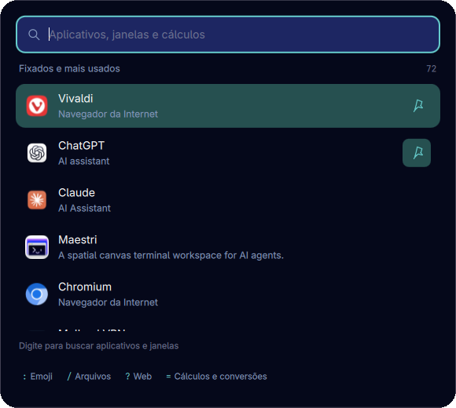
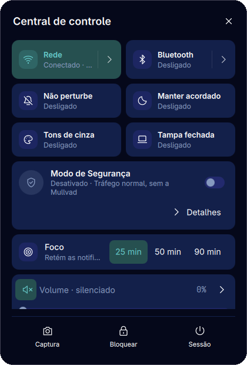
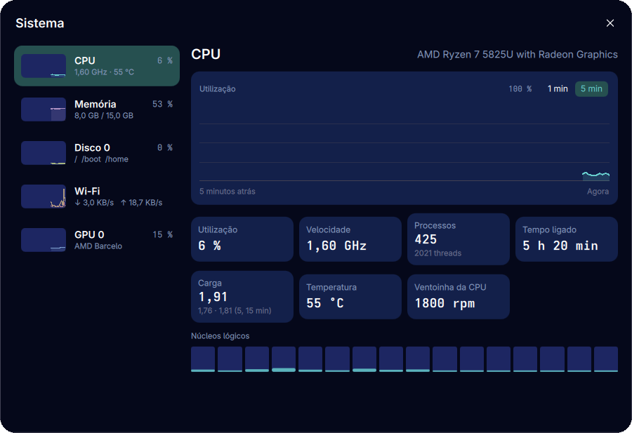
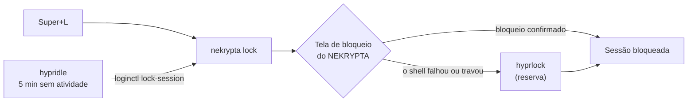
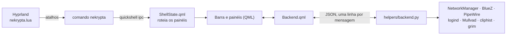

<div align="center">


# NEKRYPTA

Um shell de desktop pessoal para Hyprland, feito com [Quickshell](https://quickshell.org).<br>
Barra compacta, painéis, Central de Controle, tela de bloqueio e um Modo de Segurança integrado à Mullvad.

[Funcionalidades](#funcionalidades) · [Instalar](#instalar) · [Configuração](#configuração) · [Atalhos](#atalhos) · [Bloqueio](#bloqueio-de-tela-e-inatividade) · [Problemas](#solução-de-problemas) · [Desenvolvimento](#desenvolvimento)


</div>

> [!NOTE]
> Este é um **rice pessoal**: a paleta, o local do clima, os atalhos e a política de segurança são os do autor e ficam
> fixos em [`core/personal.json`](core/personal.json). Funciona em Arch Linux com Hyprland (configuração Lua).
> Leia [Instalar](#instalar) antes de rodar o instalador: ele altera arquivos em `~/.config/hypr`, sempre com backup.

<br>

O NEKRYPTA substitui a barra, o lançador, o daemon de notificações e a tela de bloqueio de uma sessão Hyprland. Não é
um conjunto de dotfiles: o Hyprland, o terminal, os temas GTK/Qt e os papéis de parede continuam seus. O instalador
só acrescenta os arquivos do NEKRYPTA e faz cópia de segurança de tudo o que altera.

É um rice pessoal, não um shell genérico: paleta, tipografia, barra, local do clima, estilo da tela de bloqueio,
atalhos, terminal e política de segurança ficam fixados em [`core/personal.json`](core/personal.json), a única fonte de
configuração. Não há telas de configuração, importação, exportação nem editores em tempo de execução.

<table align="center">
  <tr>
    <td align="center"><br><sub><b>Lançador</b><br>aplicativos, janelas, contas e conversões</sub></td>
    <td align="center"><br><sub><b>Central de Controle</b><br>rede, Bluetooth, foco e Modo de Segurança</sub></td>
    <td align="center"><br><sub><b>Monitor do sistema</b><br>CPU, memória, discos, rede e GPU ao vivo</sub></td>
  </tr>
</table>

## Funcionalidades

| | O que faz |
|---|---|
| **Barra** | Workspaces, título da janela, relógio, temperatura, mídia com visualizador (`cava`), indicador de microfone e de tela, foco e temporizador, layout de teclado, Wi-Fi, áudio, Bluetooth, notificações, monitor do sistema, bateria e bandeja. |
| **Lançador** | Aplicativos, janelas abertas e ações. Aceita contas (`6 * 7`), conversões (`10 km to mi`), `timer 10m chá`, `focus 40`, `:` para emoji, `/` para arquivos (via `fd`) e `?` para busca na web. |
| **Central de Controle** | Wi-Fi, Bluetooth com reconexão automática, volume por aplicativo, microfone, brilho, perfis de energia, não perturbe, manter acordado, mídia com equalizador e o Modo de Segurança. |
| **Modo de Segurança** | Lockdown, LAN bloqueada e conexão Mullvad, com verificação do túnel, do IP externo e do DNS. Tailscale permitido só para o Minecraft, sem Exit Node. Veja [docs/MODO-DE-SEGURANCA.md](docs/MODO-DE-SEGURANCA.md). |
| **Notificações** | Histórico agrupado, ações e persistência opcional. Substitui mako, dunst e semelhantes. |
| **Foco e temporizadores** | Sessão cronometrada que segura as notificações e resume o que chegou, além de contagem regressiva. |
| **Tela de bloqueio** | Autenticação PAM sobre `ext-session-lock`, com a hora em partículas de luz. O `hyprlock` assume se o shell falhar com a sessão bloqueada. |
| **Papéis de parede** | Pastas locais, Wallhaven e Wallpapers.com, aplicados por `hyprpaper`, `awww` ou `swww`. |
| **Área de transferência** | Histórico com prévias de imagem e de cores (`cliphist`). |
| **Calendário e clima** | Calendário e previsão pelo Open-Meteo, sem chave de API. |
| **Captura** | Captura de tela (região ou tela inteira), gravação com áudio do sistema ou do microfone e seletor de cor. |
| **Monitor do sistema** | CPU, memória, discos, rede, GPUs, temperaturas e ventoinhas ao vivo. |
| **Menu de sessão** | Bloquear, suspender, sair, reiniciar e desligar. |

## Instalar

Requisitos: Arch Linux (o instalador usa `pacman`), Hyprland 0.56+ com configuração Lua
(`~/.config/hypr/hyprland.lua`), Quickshell 0.3.1+, serviços de usuário do systemd e PipeWire.
[`dependencies.txt`](dependencies.txt) lista os pacotes; o instalador calcula quais a máquina realmente precisa
(extras de hardware como `upower`, `brightnessctl` e `bluez` só entram se o hardware existir) e pede confirmação antes
de usar `sudo pacman`.

Para o Modo de Segurança é preciso o cliente da Mullvad (versão compatível com o backend, atualmente 2026.4) com o
daemon em execução, além de `ss` (`iproute2`). Sem isso o restante do shell funciona. O Tailscale é opcional.

```sh
git clone https://github.com/Pedrojscx/NEKRYPTA.git ~/src/nekrypta
cd ~/src/nekrypta
python3 scripts/install.py     # prévia: mostra o que mudaria, sem escrever nada
./install.sh                   # instala (use --no-packages para não mexer em pacotes)
hyprctl reload
```

Não clone diretamente em `~/.config/quickshell/nekrypta`: esse é o destino da instalação.

O NEKRYPTA é a barra e o daemon de notificações. Tire `waybar`, `mako`, `dunst`, `swaync` e similares da
inicialização, ou os dois vão disputar a mesma função (o instalador avisa quando encontra algum rodando).

O que o instalador faz:

- copia o shell para `~/.config/quickshell/nekrypta` e instala o comando `~/.local/bin/nekrypta`;
- instala a unidade `~/.config/systemd/user/nekrypta.service`;
- escreve `nekrypta.lua`, `nekrypta-hypridle.conf` e `nekrypta-hyprlock.conf` em `~/.config/hypr` e acrescenta uma
  linha em `hyprland.lua` que carrega `nekrypta.lua`;
- pergunta antes de substituir um atalho seu que conflite (`--yes` aceita todos; `--ask-again` volta a perguntar pelos
  que você escolheu manter);
- guarda uma cópia de cada arquivo alterado em `~/.local/state/nekrypta/backups/`.

<details>
<summary><b>Outras opções do instalador</b></summary>

`--wallpaper-shortcut` liga `Super+Shift+W` ao seletor de papéis de parede; `--shell-only` atualiza só o
shell e o comando; `./install.sh --uninstall` remove tudo e restaura o que foi substituído (`--purge` apaga também
configurações e backups); `python3 scripts/install.py --rollback <pasta-do-backup> --apply` desfaz uma instalação.
Para atualizar uma cópia local, rode `./install.sh` de novo. Instalações feitas com o nome anterior do projeto são
migradas de forma explícita, veja [docs/INSTALACAO-NEKRYPTA.md](docs/INSTALACAO-NEKRYPTA.md).

</details>

## Executar

Com o shell instalado, ele sobe com a sessão: o `nekrypta.lua` roda `nekrypta start` quando o Hyprland inicia.
Manualmente:

```sh
nekrypta start       # inicia nekrypta.service
nekrypta restart     # reinicia (rode depois de atualizar)
nekrypta stop
nekrypta logs        # últimas linhas do journal do serviço
nekrypta status      # estado do shell em JSON
nekrypta help        # todos os comandos
```

Para testar sem instalar, a partir do repositório: `quickshell --path shell.qml` (a barra e as notificações precisam
estar livres de outros programas, como descrito acima).

Todo painel também é comando: `nekrypta launcher`, `clipboard`, `control`, `notifications`, `calendar`, `capture`,
`power`, `wallpaper`, `system`, `lock`, `screenshot [region|output]`, `page PAGE`, `focus [MINUTOS|toggle|end]`,
`timer DURAÇÃO [RÓTULO]`, `color`, `dnd [on|off]` e `stop-recording`.

## Configuração

Tudo o que é escolha de aparência ou política está em [`core/personal.json`](core/personal.json).

<details>
<summary><b>Seções de <code>core/personal.json</code></b></summary>

| Seção | O que define |
|---|---|
| `identity` | Nome, idioma (`pt_BR`) e terminal (`kitty`). |
| `palette`, `typography`, `motion` | Cores, fontes e redução de movimento. |
| `bar` | Estilo, tamanhos, itens de cada lado, relógio e o local do clima (nome, latitude e longitude). |
| `wallpaper`, `capture` | Pasta de papéis de parede, de capturas e de gravações (`~/Pictures/...`, `~/Videos/...`). |
| `lock` | `screen` (`builtin` ou `hyprlock`) e `style`. |
| `security` | Política do Modo de Segurança, incluindo a exceção do Tailscale para o Minecraft. |
| `shortcuts` | Os atalhos que o instalador escreve em `nekrypta.lua`. |
| `operationalDefaults` | Padrões das preferências operacionais (não perturbe, busca na web, áudio da gravação etc.). |

</details>

O local do clima vem como um exemplo: troque `bar.temperature.location` pelo seu. Depois de editar, rode
`./install.sh` (ou `python3 scripts/install.py --apply`) e `nekrypta restart`. Os atalhos só mudam no Hyprland depois de
reinstalar e de `hyprctl reload`.

| O quê | Onde |
|---|---|
| Estado operacional, escolhas de papel de parede, snapshot do Modo de Segurança, backups | `~/.local/state/nekrypta/` |
| Cache (miniaturas, clima) | `~/.cache/nekrypta/` |
| Runtime | `$XDG_RUNTIME_DIR/nekrypta/` |
| Integração com o Hyprland | `~/.config/hypr/nekrypta.lua`, `nekrypta-wallpaper.lua`, `nekrypta-hypridle.conf`, `nekrypta-hyprlock.conf` |

O snapshot do Modo de Segurança (`security-session.json`, permissões 0600) não é um backup: guarda o que a sessão
protegida alterou para que possa ser restaurado, inclusive depois de reiniciar o shell.

Perfis de energia: o shell usa os perfis do provedor de energia do sistema (`power-profiles-daemon`, que o instalador
adiciona em notebooks sem outro provedor). Com TLP ou auto-cpufreq, os modos de energia do shell ficam ocultos.

## Atalhos

| Atalho | Ação | Atalho | Ação |
|---|---|---|---|
| <kbd>Super</kbd> <kbd>Espaço</kbd> | Lançador | <kbd>Super</kbd> <kbd>R</kbd> | Lançador (mesma ação) |
| <kbd>Super</kbd> <kbd>V</kbd> | Área de transferência | <kbd>Super</kbd> <kbd>A</kbd> | Central de Controle |
| <kbd>Super</kbd> <kbd>N</kbd> | Notificações | <kbd>Super</kbd> <kbd>M</kbd> | Menu de sessão |
| <kbd>Ctrl</kbd> <kbd>Shift</kbd> <kbd>Esc</kbd> | Monitor do sistema | <kbd>Super</kbd> <kbd>L</kbd> | Bloquear |
| <kbd>Super</kbd> <kbd>Shift</kbd> <kbd>W</kbd> | Papéis de parede (opcional) | <kbd>Super</kbd> <kbd>Print</kbd> | Captura e gravação |
| <kbd>Print</kbd> / <kbd>Shift</kbd> <kbd>Print</kbd> | Captura de região / tela | | |

## Bloqueio de tela e inatividade

Há um único bloqueador ativo: a tela de bloqueio do próprio NEKRYPTA. O `hyprlock` só entra como reserva, se o shell
travar ou cair com a sessão bloqueada (`misc:allow_session_lock_restore` fica ligado), e nunca ao mesmo tempo que ele.



O bloqueio por inatividade é feito pelo `hypridle`, com `nekrypta-hypridle.conf`:

| Inatividade | O que acontece |
|---|---|
| 4 minutos | O brilho baixa para 10% (e volta ao mexer). |
| **5 minutos** | A sessão é bloqueada (`loginctl lock-session`, que chama `nekrypta lock`). |
| 7 minutos | A tela é desligada (DPMS) e volta ao mexer. |

Antes de suspender, o hypridle também bloqueia a sessão. Esses tempos ficam em `integration/hypridle.conf`.

O `nekrypta start` sobe o hypridle com essa configuração **somente se** você não tiver um hypridle rodando ou habilitado.
Se já usa o seu, faça-o chamar `~/.local/bin/nekrypta lock` como `lock_cmd`, ou ele não vai usar a tela do NEKRYPTA.

## Solução de problemas

<details>
<summary><b>O shell não aparece ou fecha</b></summary>

`nekrypta logs` mostra o journal. `nekrypta restart` reinicia o serviço. Confirme que
o Hyprland usa `hyprland.lua` e que ele carrega `nekrypta.lua`.

</details>

<details>
<summary><b>Notificações não chegam</b></summary>

Outro daemon (`swaync`, `mako`, `dunst`) está dono de `org.freedesktop.Notifications`; o log
mostra "Could not register notification server". Descubra com `busctl --user status org.freedesktop.Notifications`, tire o
daemon da inicialização e reinicie o shell.

</details>

<details>
<summary><b>A tela não bloqueia sozinha</b></summary>

Verifique `pgrep -ax hypridle` e se ele usa `nekrypta-hypridle.conf`. Qualquer programa
que inibe a inatividade impede o bloqueio: vídeo em tela cheia, chamadas, o "Manter acordado" da Central de Controle,
entre outros. `hyprctl clients -j` mostra `inhibitingIdle: true` nas janelas responsáveis.

</details>

<details>
<summary><b>Um atalho não funciona</b></summary>

Outro atalho seu pode ter ficado com a tecla. Rode `python3 scripts/install.py --apply --ask-again`
para decidir de novo, e `hyprctl reload`. `hyprctl binds` lista o que está registrado.

</details>

<details>
<summary><b>A tela de bloqueio não é a do NEKRYPTA</b></summary>

Confira `lock.screen` em `core/personal.json` (`builtin`) e se o seu
`hypridle` chama `nekrypta lock`.

</details>

<details>
<summary><b>Modo de Segurança indisponível</b></summary>

O daemon da Mullvad precisa estar rodando e logado. Para desfazer à mão, depois de
verificar a rede: `mullvad disconnect`, `mullvad lockdown-mode set off` e, se a LAN estava liberada,
`mullvad lan set allow`.

</details>

<details>
<summary><b>Papéis de parede não mudam</b></summary>

Instale `hyprpaper` (ou `awww`/`swww`) e verifique a pasta `wallpaper.directory`.

</details>

<details>
<summary><b>Voltar ao estado anterior</b></summary>

`python3 scripts/install.py --rollback <pasta-do-backup> --apply`, com a pasta listada em
`~/.local/state/nekrypta/backups/`, ou `./install.sh --uninstall`.

</details>

## Desenvolvimento

`shell.qml` cria uma barra, o host dos painéis e as camadas por saída. `core/ShellState.qml` roteia os painéis e expõe o
alvo IPC `shell`; `core/PersonalConfig.qml` lê `core/personal.json` e `core/Theme.qml` deriva dele cores, tamanhos e
tipografia. Todo o resto (rede, Bluetooth, energia, captura, segurança) passa por um helper Python,
`helpers/backend.py`, com o qual `core/Backend.qml` conversa em linhas JSON:



```json
{"id": 1, "method": "security.status", "params": {}}
{"id": 1, "ok": true, "result": {"state": "desativado"}}
```

| Comando | Para quê |
|---|---|
| `python3 -m pytest tests` | Testes do backend e da configuração (requer `python-pytest` e `python-pytest-asyncio`). |
| `python3 scripts/check-live.py --installed` | Abre e fecha cada painel no shell instalado e confere o roteamento. |
| `python3 scripts/build-icons.py` | Regenera `core/icons.js` depois de mudar um SVG em `assets/icons`. |

Documentação de apoio: [`docs/architecture`](docs/architecture) (contratos de rede, segurança e códigos de erro).

---

<sub>Clima por [Open-Meteo](https://open-meteo.com). Papéis de parede de [Wallhaven](https://wallhaven.cc) e [Wallpapers.com](https://wallpapers.com).
Origem do projeto e créditos em [docs/ATRIBUICAO.md](docs/ATRIBUICAO.md).</sub>
